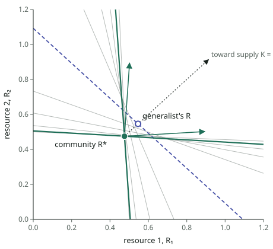

# Assembly through the field

**Status.** A report: the mathematics of assembly with adjoints, a worked example with 50 traits
checked against algebra, and the lean algorithm that survived refactoring. Numbers are
measured on the example (`spikes/assembly-example/`, output in `assembly.txt`) unless marked
*derived* or *estimated*. Published as an artifact from `assembly-report.html`, which has the
same content.

**Findings.**
- **Species interact only through a shared field** (light, water). The Jacobian of the
  assembly problem is each species' own curvature plus a field term of rank at most d, the
  field's effective dimension. A Newton step reduces to a (d + m)-sized system in field
  coordinates (*derived*).
- **Fifty traits separate along at most d directions** (*derived*):
  - lineages split only where a trait changes both what the plant depends on in the field and
    the field it makes;
  - at most d species coexist;
  - every other trait is a best response in the shared field, the problem EEO models solve.
- **The lean algorithm is column generation with structured Newton passes.**
  - Each pass is one resident run, curvature probes in parallel, and one rank-d
    complementarity problem.
  - There is no equilibrium loop, and no separate birth, death, split or merge steps.
- **On the example:**
  - with 2 resources it reaches the algebra's community in 9 resident runs, exact to 3.5e-14;
  - with 3 resources it assembles all three species in 27;
  - the one-shot route of `field-cut.md` needs 2,182 runs and does not converge.
- **The refactor removed six kinds of work and kept four.** Removing any of the four made
  the example diverge or slow down (§7).

## 1. The objects

Species i = 1…m have traits θ_i ∈ ℝᵏ and density (seed rain) N_i. The residents make a field
E = 𝓔(θ, N): light by height and patch age, and water by layer and time. Invader fitness
φ(θ′; E) is computed in a held field, and a resident is an invader at its own traits:

$$F_i(\theta, N) = \varphi\big(\theta_i;\ \mathcal{E}(\theta, N)\big).$$

| Symbol | Meaning | Source |
|---|---|---|
| $g_i = \partial_{\theta'}\varphi(\theta_i;E)$ | selection gradient, field held | the cut sweep of the residents' recording |
| $S_i = \delta\varphi(\theta_i;E)/\delta E$ | sensitivity: what the species depends on in the field | the adjoints the cut zeroes |
| $c_j = \partial\mathcal{E}/\partial N_j$ | impact: what one more individual does to the field | sweeps of the recording |
| $E_{\theta_j} = \partial\mathcal{E}/\partial\theta_j$ | how a resident's traits change the field | sweeps of the recording |
| $H_i = \partial^2_{\theta'\theta'}\varphi$ | curvature of invader fitness, field held | k gradient probes in the held field |
| $G_i = \partial g_i/\partial E$ | how selection depends on the field | the same probes (each returns S too) |

## 2. What one recording returns

$$\frac{\partial F_i}{\partial \ln N_j} = \langle S_i, c_j\rangle N_j, \qquad
\frac{\partial F_i}{\partial \theta_j} = \delta_{ij}\, g_i + \langle S_i, E_{\theta_j}\rangle.$$

The first is Meszéna's $a_{ij} = S_i\cdot C_j$, whose determinant measures how robustly the
species coexist.

**The field cut.** Reverse mode sums derivatives over paths through the recorded
computation.
- Zeroing each field value's adjoint, once all its readers have been swept, deletes every
  path through the field.
- What remains is the derivative with the field held: g on the traits, and zero on N.
- The adjoint zeroed is S.
- One cut sweep of $\sum_i F_i$ returns every $g_i$, since with the field held $F_i$ reaches
  no other species' inputs.

It is proved on a C++ toy against odelia's XAD: g matches the invader's bit for bit, at 0.99
the cost of an ordinary sweep (`spikes/field-cut/`).

## 3. The assembled community

Over residents and every candidate strategy p:

$$N_p \ge 0,\quad \varphi(\theta_p;E^*) \le 0,\quad N_p\,\varphi(\theta_p;E^*) = 0,\quad
g_i = 0\ \text{(residents)},\qquad E^* = \mathcal{E}(\theta, N).$$

Residents sit at zero-height peaks of one landscape φ(·; E*), and nothing else in trait space
is above zero. Births, deaths, equilibrium, evolution, splits and merges are all moves toward
this one set of conditions.

## 4. A Newton step in field coordinates

Every tracked strategy p steps toward its best response in the field E + δE. The field
responds to density changes and to the residents' trait steps:

$$\delta\theta_p = -H_p^{-1}(g_p + G_p\,\delta E), \qquad
\delta E = \sum_p c_p\,\delta N_p + \sum_{j\in\text{res}} E_{\theta_j}\,\delta\theta_j.$$

Substituting leaves a d × d system for the field:

$$Q\,\delta E = C\,\delta N + r,\qquad Q = I + \sum_j E_{\theta_j} H_j^{-1} G_j,\qquad
r = -\sum_j E_{\theta_j} H_j^{-1} g_j.$$

Each strategy's peak height after its step is, from its quadratic model, linear in δE:

$$\tilde\varphi_p + \tilde s_p\cdot\delta E,\qquad
\tilde\varphi_p = \varphi_p - \tfrac12 g_p^\top H_p^{-1} g_p,\qquad
\tilde s_p = S_p - G_p^\top H_p^{-1} g_p.$$

The new densities solve one linear complementarity problem:

$$N^+ \ge 0,\quad w = q + M N^+ \le 0,\quad N^+_p w_p = 0,\qquad
M = \tilde S Q^{-1} C,\quad q = \tilde\varphi + \tilde S Q^{-1}(r - C N).$$

- M has rank at most d, so at most d strategies take positive density: Meszéna's bound as
  linear algebra.
- At the root g = 0, so $\tilde s = S$.
- Traits then step by δθ_p, and everything is scaled by one trust factor (§7).
- The step is exact Newton when H, G, S, c and E_θ are exact. No dense mk × mk Jacobian
  appears.

## 5. What fifty traits can separate

For one resident, with the equilibrium re-solved:

$$J = H + M_\theta,\qquad M_\theta = G\,\frac{dE^*}{d\theta},\qquad
\frac{dE^*}{d\theta} = E_\theta - c\,F_N^{-1}F_\theta.$$

1. **rank M_θ ≤ d.** It factors through the field, whatever k is.
2. **Lineages split only through the field.** At a strongly convergence-stable point
   (J + Jᵀ ≺ 0), a disruptive direction v (vᵀHv > 0) needs

   $$v^\top M_\theta v = \big\langle G^\top v,\ \tfrac{dE^*}{d\theta}v\big\rangle < 0.$$

   The strategy must change what it depends on in the field and change the field it makes,
   with opposite sign. On null(M_θ), at least k − d dimensions, J = H: convergence stability
   implies ESS, and those directions never split.
3. **At most d species.** m zero-height peaks are m conditions on a field with d robust
   directions.
4. **The other traits follow from niche position.** Each resident's non-separating traits are
   its best response given its position on the separating axes. Species in one community
   differ along at most d − 1 directions, and the rest follow as syndromes.
5. **EEO and assembly divide the work.** A best response in a given field is what an EEO
   model computes. It is right for the traits that follow from niche position once given the
   niche position and E*, and cannot supply either.

## 6. A worked example

MacArthur competition for d resources at positions z_r with supply K_r, and k = 50 traits:
- x places uptake on the resource axis, $a_r(x) = e^{-(x-z_r)^2/2\sigma^2}$;
- v is uptake capacity at cost cv²/2;
- 48 physiological traits w_l have optimum ω_l x and stiffness q_l.

$$R = K - \sum_j N_j v_j a(x_j),\qquad
\varphi(\theta;R) = v\,a(x)\cdot R - \mu - \tfrac{c}{2}v^2 - \tfrac12\sum_l q_l (w_l - \omega_l x)^2.$$

μ = 0.125 and c = 1; ω_l and q_l are drawn once from [−1, 1] and [0.5, 5]. The field is exactly
d-dimensional, with S = v a(x) and c_j = −v_j a(x_j).

### By hand: two resources (z = 0, 1; K = 2, 2; σ = 0.4)

**The other traits come first:**
- $w^* = \omega x$, a fixed syndrome;
- $v^* = a(x)\cdot R/c$, set by the field, as in EEO.

That leaves $\hat\varphi(x;R) = (a(x)\cdot R)^2/2c - \mu$. A strategy breaks even on the line
$a(x)\cdot R = \sqrt{2c\mu} = 0.5$, its zero-net-growth isocline. At break-even v* = 0.5 in
every resident.

**The generalist, x = ½:**
- R = c v*/2a₀ = 0.546050 and N = 6.351437, with a₀ = e^{−1/8σ²};
- H = 2vRa₀(1/4σ⁴ − 1/σ²) = 0.879 > 0;
- M = −Nv²a₀²/2σ⁴ = −6.501, so J = −5.622.

It attracts and is a fitness minimum: a branching point.

**The pair.** In a symmetric field, $g_x = 0$ does not involve R:

$$\ln\frac{x}{1-x} + \frac{1-2x}{2\sigma^2} = 0 \ \Rightarrow\ \bar x = 0.060134,\ 1-\bar x = 0.939866.$$

Break-even gives R = c v*/s̄ = 0.475274, with s̄ = a₁(x̄) + a₂(x̄). Supply sets N = (K − R)/(v* s̄) =
2.898648 each. The landscape $\hat\varphi(\cdot;R)$ peaks at exactly zero at x̄ and 1 − x̄.



*Figure 1.* The resource plane. Each strategy breaks even on one line; it grows above its line
and declines below it. The community sits where the specialists' lines (green) meet, below
every other line. The arrows from it are the pair's consumption directions, reversed;
supply lies inside the cone they span. The generalist's equilibrium (open circle) sits above
the specialists' lines, which is why they invade it.

### The algorithm beside the algebra

| Step | Algebra | Algorithm |
|---|---|---|
| Round 1, pricing in R = K | x̄ does not involve R in a symmetric field, so it is final. v* = a(x̄)·K/c = 2.09, w* = ωx̄, and the peak height is 2.09 | 13 BFGS ascents, each seeded with one curvature probe, merge to x = 0.060134 and 0.939866, φ = 2.09 |
| Pass 1 | the complementarity matrix has rank 2, so both specialists can enter | no residents and no run; both enter at N = 0.27 (trust-limited) |
| Passes 2–8 | x stays at x̄; v* = a(x̄)·R/c falls with R; w exact from the first step | resident runs 1–7: v 1.47 → 0.906 → 0.730 → 0.577 → 0.527 → 0.502 → 0.50006; N → 2.898; \|F\| 1 → 7e-5 |
| Passes 9–10 | Newton's quadratic tail | \|F\|, \|g\| 3e-8, then 4e-15; the algebra to 3.5e-14 |
| Round 2, pricing in R* | $\hat\varphi(\cdot;R^*)$ peaks at exactly 0 at the residents | the best φ is 3.9e-15, so nothing enters. Totals: 9 resident runs, 3,472 invader evaluations (1,772 of them pricing) |

The run never visits the branching point. Evolving one resident first means climbing to
x = ½, detecting the branching, splitting and resolving a nearly singular pair.

### Three resources, unequal supply (z = 0, 0.5, 1; K = 2, 1.5, 1; σ = 0.22)

- **Round 1** finds one peak, which climbs to its singular point in the field it makes,
  x = 0.2087.
- **Round 2** finds two entrants. The active set churns for three passes: one entrant leaves
  and re-enters, and another briefly reaches x = −0.25. Then it converges quadratically, and
  the round-1 resident ends as the middle specialist.
- **Round 3** certifies: three species, d of them, at x = 0.0566, 0.5000 and 0.9434, all with
  v = 0.5. 27 resident runs.

**The field does not depend on supply when m = d.** Break-even and selection are d + dk
equations in d field coordinates and dk traits, and supply appears in none of them.
K = (1, 1.5, 2) and K = (1.5, 1.5, 1.5) give the same R* = (0.458364, 0.430719, 0.458364) and the
same species to six decimals; only N changes. This is Tilman's R* rule, extended to many
traits, and it is exact only for a finite-dimensional field.

### The routes compared

| Route | d = 2: resident runs | invader evaluations | reaches the community? | d = 3: resident runs |
|---|---|---|---|---|
| **Lean** | **9** | 3,472 | yes, to 3.5e-14; certified | **27** (3 species) |
| One-shot: to the branching point, split, then the pair | 2,182 | 1,822 | not within 2,000 steps (\|g\| 9e-4) | — |
| FitMax mock, Newton equilibria, residents not evolved | 20 | 2,749 | no: residents keep their birth traits (\|g\| ≈ 1) | 20 (2 species) |

The FitMax row is a mock, not regnans:
- its birth threshold and copy rule are assumed;
- regnans's iteration, ln N ← ln N + F, oscillates here, so the mock uses regnans's Newton
  solver;
- it is cheap only because it never evolves its residents.

## 7. Where the work was redundant

| Step | Verdict | Replaced by | Evidence |
|---|---|---|---|
| Equilibrium to tolerance before each evolutionary step | redundant | densities move with traits | C++ toy: 14 runs against 46 and 280 |
| Separate birth, death, split, merge, label, classify | redundant | one complementarity problem over tracked peaks, plus pricing between rounds | the pair found without the branching point |
| A step to find the separating subspace | redundant | differences between peaks; G from the probes | species differ in x; v and w follow to 1e-15 |
| Broyden over all mk traits | redundant, and fragile | per-strategy curvature plus the rank-d field term | 2,182 runs unconverged against 9 |
| Full curvature every pricing iteration | redundant | BFGS seeded by one probe | pricing 8,951 → 1,772 evaluations |
| Pricing every pass | redundant | pricing when the master converges | 2–3 rounds |
| Full curvature every pass | a trade, not redundant | directional update: one full probe a round, then d + 1 probes along the last step and the best-response shifts | d = 2: master evaluations 1,700 → 932 at the same 9 runs; d = 3: 3,457 → 1,446, but 27 → 44 runs |

**Kept, because removing them failed:**
- **The residents' trait-to-field feedback,** Q and r. At the same trust radius, d = 2 takes
  17 runs instead of 11 without it, and d = 3 diverges to 29 spurious species.
- **Curvature that is current along the directions that move.** Reusing curvature unchanged
  across passes is harmless at d = 2 and diverges at d = 3. The directional update keeps it
  current at (d + 1)/k of the cost.
- **A trust region in fitness units,** capping ½δθᵀ(−H)δθ. A cap in trait units let x jump
  4.5σ and diverged.
- **An exact residual every pass.** F and g come from a real run, so approximate Jacobians
  do not move the answer.

## 8. The lean algorithm

```
round r = 1, 2, …
  pricing (parallel): BFGS ascents of φ(·; E) from starts along the separating axes and near residents
  if no peak has φ > 0 that is not a resident: stop                          # the certificate
  tracked ← residents ∪ new peaks (N = 0)
  pass t = 1, 2, …
    record residents → F, g and S (cut sweep), c and E_θ (sweeps)            # sequential
    curvature of every tracked strategy: full on the first pass,
      then along the last step and H⁻¹G (d + 1 probes)                       # parallel
    Q, r, φ̃, s̃ → LCP for N⁺ (rank d) → δE → δθ_p for every tracked strategy
    scale (δN, δθ) by one trust factor; apply
    if |F|, |g| small and every candidate below zero: end pass
  drop strategies with N = 0
```

**In plant:**
- **The resident run** is one recording. The cut sweep gives g and S, and mode-seeded sweeps
  give c and E_θ projected on the field's leading modes.
- **The modes** are the leading directions of the tracked strategies' sensitivities, which
  every invader sweep returns.
- **Probes** are invader gradients in the recorded field, or Hessian–vector products.
- **Pricing** is invader ascent in a held field. The same routine serves EEO, pricing and
  best responses.

Projection onto modes approximates only the Jacobian; the residual stays exact.

**Cost per pass in TF24** (*estimated*):

| Item | Cost |
|---|---|
| Recording of m residents plus d′ + 1 sweeps (sequential) | about 2m + 0.5(d′ + 1) F; 8 F at m = d′ = 3 |
| Curvature probes at about 2.5 F each (parallel) | full: tracked × k, 500 F of CPU at 4 × 50; directional: tracked × (d + 1), 40 F |
| Passes to the community | 9 (d = 2) and 27–44 (d = 3) on the example |

- **Wall time** is about 27 passes × (8 + 2.5) F ≈ 280 F, roughly 4–5 hours at 1 min per F.
- **CPU** is about 13,000 F with full probes. With directional probes it falls to a few
  thousand F, mostly the first full probe each round, at the cost of more passes.
- **Comparison:** the roadtest's single regnans step took 54–79 minutes, and one regnans
  singular strategy in one trait costs about 608 F.

## 9. What is not yet shown

- **Plant's field is a function**, of height, patch age and time. Modes project it, and d is
  unmeasured in TF24.
- **The pricing certificate** is "no peak above zero among the ascents". In 50 traits it is
  credible only if starts cover the separating directions, which §5 says are few.
- **Discrete schedules.** In TF24 the node schedule must be held through a solve and
  certified at the root (`../schedule/workflows.md` §6).
- **The field cut in plant** is not built, and its cost there is unmeasured.

## Sources

- `spikes/assembly-example/assembly.R`, `assembly.txt`;
- `spikes/field-cut/`;
- `field-cut.md`, `assembly.md`.

Theory: Meszéna et al. 2006; Leimar 2009; Metz, Mylius & Diekmann 2008; Tilman 1982;
MacArthur 1970.
